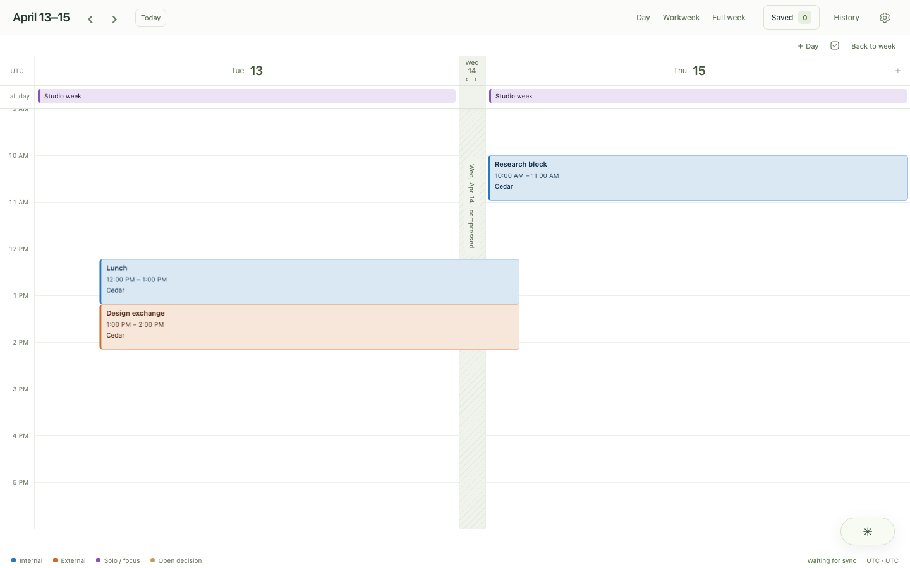
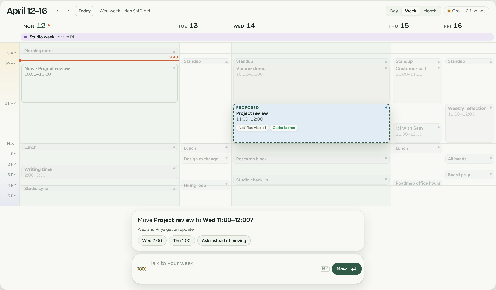
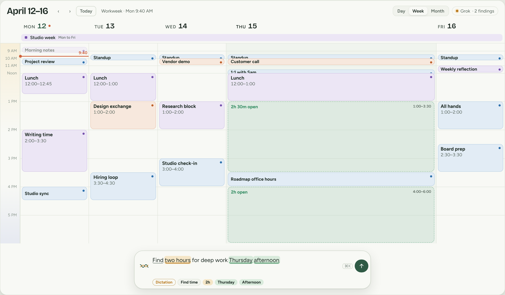

Most calendars have been stuck in the same pose for years. Days across the top, hours down the side, colored rectangles for everything else. I actually like that part. You can look at a week and immediately see that Tuesday is a disaster.

What I don't like is what happens next. Making room for something means dragging blocks, opening dialogs, doing a little mental arithmetic, and repeating. An AI assistant can take the instruction, but often moves the work into a chat window. Now I have to read what it proposes and translate the answer back into the calendar.

I started building Dayweave with that problem in mind. The assistant could already find events, understand invitations and propose calendar changes. But I kept coming back to the same question: **why was the calendar still just sitting there?**

The screenshots and interactive examples below come from the actual Dayweave design archive and frontend. The demonstration uses an invented calendar and scripted responses. Nothing here reads anyone's real schedule or sends invitations.

## First, I tried moving the assistant around

The first designs were fairly predictable. Put the controls next to the event. Show the existing week beside a proposed week. Add a quiet concierge for decisions that need attention.

They were reasonable ideas, but none solved the problem. The calendar was still a static surface with another interface bolted onto it. I was spending time designing the assistant's furniture.

The more useful question was whether the calendar itself could change shape.

## A calendar doesn't have to give every day equal space

I went back to an older idea: the *fisheye view*. In 2003, Benjamin Bederson and colleagues published [*A Fisheye Calendar Interface for PDAs: Providing Overviews for Small Displays*](https://www.cs.umd.edu/~bederson/images/pubs_pdfs/p618-bederson.pdf), describing **DateLens**. Tap one date, it expands; surrounding dates shrink but remain in view. It is an elegant answer to a surprisingly persistent problem: how do you look closely at something without losing where you are?

That became the most useful direction in Dayweave. Ask about Wednesday and Thursday, and those days can take up most of the screen. Tuesday doesn't disappear. It becomes a narrow, labeled strip between the things that matter. The relevant hours can expand too, while the rest of the day compresses.

<figure class="dw-figure">
  
  <figcaption>In Dayweave, skipped dates stay visible as labeled strips. Click one and it opens again. The screenshot uses fictional data.</figcaption>
</figure>

This is more than zooming in. The surrounding week is still useful context. And every column uses the same time scale, so a meeting isn't visually shorter just because another day got more room.

There were a few competing experiments. *Shape the week* let you draw the time you wanted and see what would have to move. *Calendar with depth* opened up busy slots to reveal invitation details and evidence. Both taught me something, but both risked becoming another interface to learn. Elastic time was the foundation worth keeping.

[Try the original three interactive design directions](/public/experiments/dayweave/02-calendar-in-motion.html). They're preserved as they were, not reconstructed for this article.

## Then I tried letting the conversation change the picture

Consider a fictional request: “Could we move Project review to Wednesday?”

In an ordinary chat interface, the answer might be a list of available times. Dayweave's conversation prototype did something more useful. Tuesday remained visible as the original booking. Wednesday widened. Possible destinations appeared on the calendar. Then the facts arrived, one at a time: a guest was busy at 10, a writing hold would have to move for 2:30, and the room still hadn't been verified.

<figure class="dw-figure">
  
  <figcaption>One of the living-calendar studies: the proposal and its evidence belong next to the time they affect, not in a detached paragraph.</figcaption>
</figure>

This led to a distinction I now think is essential. **Looking at a possible change is not making that change.** A dashed destination is a proposal. A checked guest is a finding. A request to an organizer isn't a rescheduled meeting. The interface has to keep those meanings straight, however smoothly things animate.

I also found myself taking things away. The permanent decision tray made the calendar feel like a task manager. A floating conversation was better, but too much explanation covered the events I was trying to understand. The answer became smaller, and the calendar kept more of the work.

[Try that earlier conversation experiment](/public/experiments/dayweave/04-calendar-in-conversation.html). It stages the checks and lets you explore an alternative without sending anything.

## The biggest change happened before pressing Enter

One of the most frustrating versions of the app looked good after a request, but did nothing *during* the request. I typed, pressed Enter and waited while the assistant thought. That still felt like a chatbot.

The current direction starts a little earlier. Type “find two hours Thursday afternoon.” Before you send anything, the calendar can recognize Thursday, afternoon and two hours. The view opens around that part of the week and highlights possible gaps. Type the name of a meeting and it can light up that meeting. Clear the sentence and that temporary preview goes away.

<figure class="dw-figure">
  
  <figcaption>The calendar starts responding to the words as they're written. Previewing is deliberately separate from asking the model to act.</figcaption>
</figure>

There is no need to call a large model for every keystroke. The immediate hints come from a small local parser and the events already on screen. The model gets involved when I actually submit the request and it needs to understand the goal, reason across constraints or propose an action.

That separation makes it feel faster. More importantly, it makes the interaction feel continuous.

## Try the actual interface

This is the Dayweave frontend running against a scripted, in-browser stand-in for its server. It uses fictional meetings, so it's safe to experiment. Type **“find two hours Thursday afternoon”**, or **“move the Design exchange to Thursday afternoon.”** You can also try **“which meetings could I skip?”** to see an answer highlighted on the events themselves.

  
<strong>Dayweave, with an invented week</strong>Interactive demo · no account · no real writes

  <iframe class="dw-demo" src="/public/experiments/dayweave/09-live-app/index.html" title="Interactive Dayweave application with fictional calendar events and scripted assistant replies" loading="lazy"></iframe>
  
<a href="/public/experiments/dayweave/09-live-app/index.html" target="_blank" rel="noopener">Open the demo full screen</a>

The scripted stand-in understands a limited set of requests. The actual application uses a model and provider checks for more complicated work, including multiple-event proposals. In either case, the point isn't that you can type a magic sentence. It's that you can stay with the week while the answer takes shape.

## What I kept

I tried more controls than I ended up wanting. A separate planning studio, a persistent decision area, heavy event cards, a scanning animation while the model worked. In isolation, most of them looked plausible. Together, they made a simple calendar feel busy in the wrong way.

The parts I keep returning to are much smaller. Let the time scale respond to attention. Keep nearby days visible, even when compressed. Show what's being considered directly on the calendar. Put the reason where the event is. Make a clear distinction between a preview, a request and an actual change. And always give me a way back to the ordinary week.

What I really want is to ask a complicated question about my time, watch the relevant pieces come into view, notice something I don't like and say, “Actually, not Thursday.” I shouldn't have to rebuild the context in a new prompt or trust a paragraph telling me that everything worked out.

Maybe calendars don't need to become chat applications. Maybe they just need to stop being quite so static.

