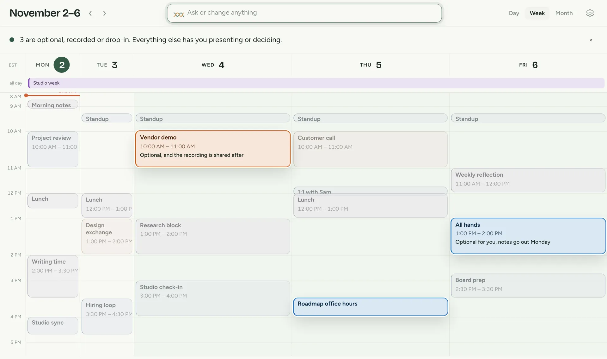
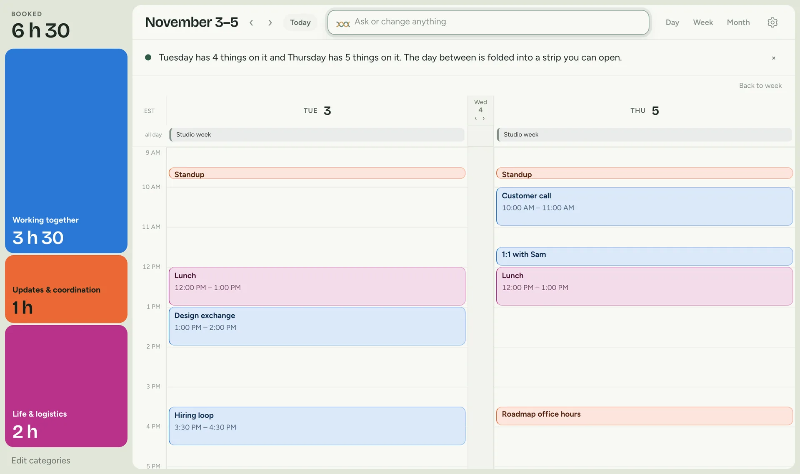
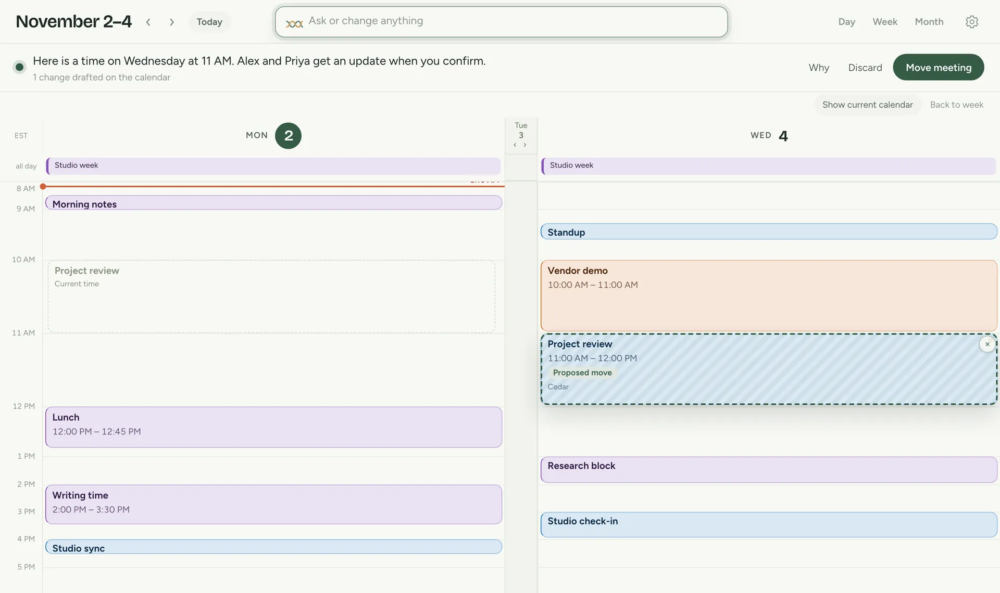
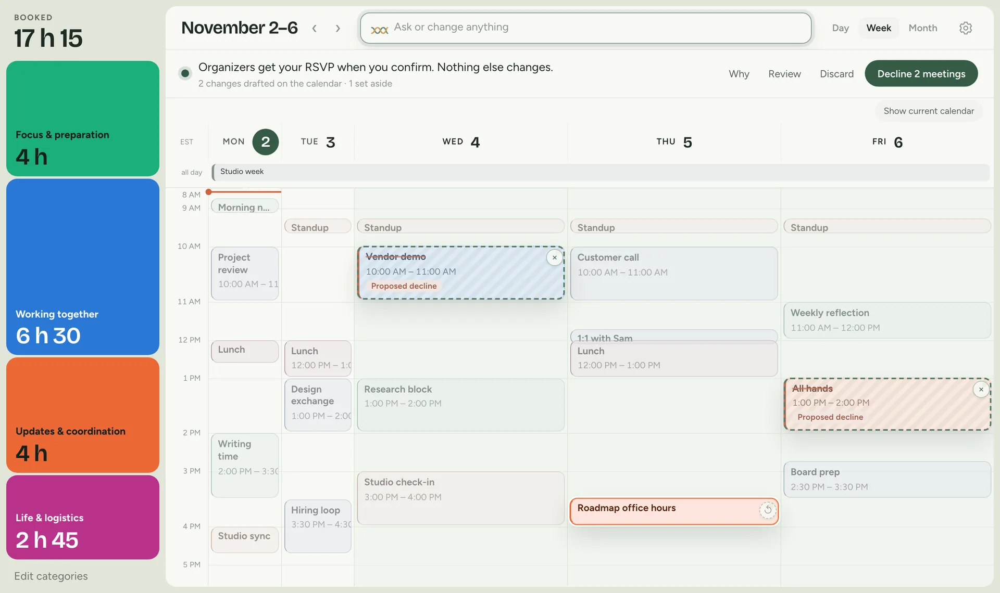
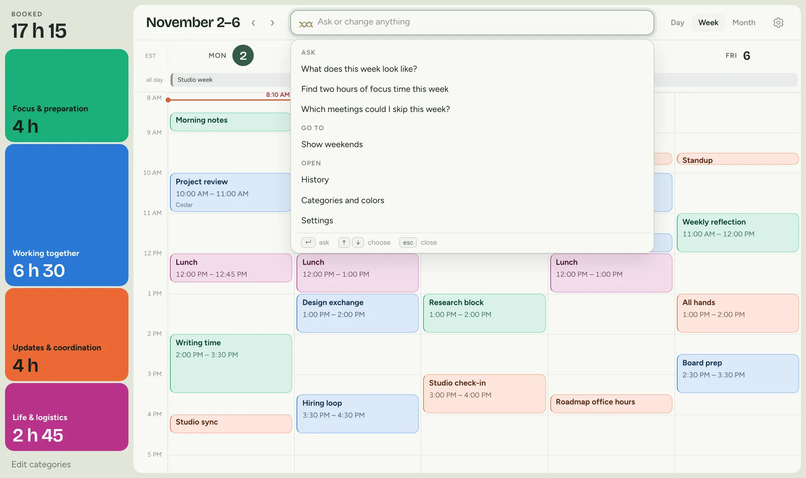

Most AI tools answer in a chat panel beside the work. Ask an assistant about a busy Thursday and it writes a paragraph about Thursday, next to a calendar that already shows Thursday. You read the paragraph and map it back onto the week yourself.

AI tools should answer where the work is. For a calendar that means three things:

1. Put the answer on the calendar
2. Draw a change before making it
3. Keep the screen quiet until there is something to say

These ideas are not new. [DateLens](https://www.cs.umd.edu/~bederson/images/pubs_pdfs/p618-bederson.pdf), a fisheye calendar from 2003, already gave the important day more room and kept the rest of the week in view. A language model makes them practical; it can decide what to show from a sentence.

I spent a week building Dayweave to test them, and every figure below is the app itself running in this page on a fictional week. You can click and type in any of them; the replies are scripted, so they follow days, times and meeting names.

## Put the answer on the calendar

<figure class="dw-stage" data-scene="skip">
  
<picture><source media="(max-width: 760px)" srcset="/public/experiments/dayweave/scenes/skip-phone.webp"></picture>

  <figcaption>"Which meetings could I skip this week?"<button type="button" class="dw-replay">Replay</button></figcaption>
</figure>

A chat panel would answer this with a list. Here the three candidates are marked where they sit, with the rest of the week still in view around them, and the reason is written inside each meeting in a few words.

In the real app the model writes those reasons, and in one test it wrote "Reflection, no agenda, easy to skip" inside a Friday hold.

The view follows the question as well: ask about two days and the calendar shows those two, with the day between them folded into a strip that opens when you click it.

<figure class="dw-stage" data-scene="compare">
  
<picture><source media="(max-width: 760px)" srcset="/public/experiments/dayweave/scenes/compare-phone.webp"></picture>

  <figcaption>"Compare Tuesday and Thursday"<button type="button" class="dw-replay">Replay</button></figcaption>
</figure>

## Draw a change before making it

<figure class="dw-stage" data-scene="move">
  
<picture><source media="(max-width: 760px)" srcset="/public/experiments/dayweave/scenes/move-phone.webp"></picture>

  <figcaption>"Move project review to Wednesday morning"<button type="button" class="dw-replay">Replay</button></figcaption>
</figure>

A sentence saying the meeting has been moved gives you nothing to check. Here the proposed time is hatched, the current time stays as an outline, and nothing is written to the calendar until you confirm.

The button names what will happen, because actions that look alike are different. Moving my own hold affects only me, while moving a shared meeting notifies its guests. Moving a meeting someone else organizes is a request, and the original time stays booked until they agree.

Declining, removing and canceling are also three different operations in Google Calendar, and only canceling emails every guest. The first test runs showed the model escalating a decline into a cancel. The instructions now forbid that, and the app rejects a plan that confuses the three.

Several changes arrive together, and each one can be dropped on its own.

<figure class="dw-stage" data-scene="decline">
  
<picture><source media="(max-width: 760px)" srcset="/public/experiments/dayweave/scenes/decline-phone.webp"></picture>

  <figcaption>"Decline those," then one is set aside<button type="button" class="dw-replay">Replay</button></figcaption>
</figure>

## Keep the screen quiet until there is something to say

<figure class="dw-stage" data-scene="quiet">
  
<picture><source media="(max-width: 760px)" srcset="/public/experiments/dayweave/scenes/quiet-phone.webp"></picture>

  <figcaption>The request bar, then two commands chosen with the arrow keys<button type="button" class="dw-replay">Replay</button></figcaption>
</figure>

The first version had about 20 buttons and labels on screen at rest; it now has the dates, one request bar, three view buttons and settings. Saved decisions, history, weekends and the rest sit behind the request bar, and a command chosen there runs without calling the model.

Getting there was mostly removal, and four things were built and then cut:

- **A floating answer card.** It covered the meetings it described.
- **A preview while typing.** For one day the calendar widened Thursday as I typed the word. It was a local guess at what the model would decide a moment later.
- **An animation that swept across the week while the model worked.** It was motion without information.
- **A fast model that handed hard requests to a slower one.** One model with read-only tools replaced both.

## Speed and cost

Answering on the calendar only works if the calendar moves quickly, so these were measured on a fictional three-week calendar with Claude Opus 5.5.

| Request | Standard | Fast mode |
|---|---|---|
| A lookup | 3 to 4 seconds | 1.5 seconds |
| A plan for the week | about 12 seconds | about 6.5 seconds |

Fast mode costs twice as much per token. The model writes the view before it writes the reply, so the calendar moves at about 2 seconds on a lookup while the sentence is still arriving. Twelve test requests, run three times each, passed 36 of 36.

The [full demo](/public/experiments/dayweave/09-live-app/) opens the app on its own page.

